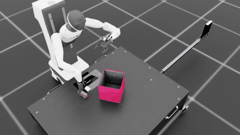
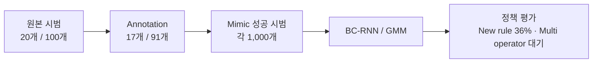

# Agibot Toy2Box 모방학습

**Agibot 오른팔로 트럭을 집어 상자 안에 놓는 정책**을 학습한다. 연구 축은 **조작자 1명 vs 다수**이며, 시범 구성과 동작 순서가 정책 성능에 어떤 차이를 만드는지 살펴본다.

New rule 원본 **20개**, Multi operator 원본 **100개**를 준비하고, annotation 후 각 조건의 Mimic 성공 시범을 **1,000개씩** 확보했다. New rule의 학습 모델은 시드 **101**, epoch **2000**이며, **100회 평가 성공률은 36% (36/100)**다.

## 1. 정책 동작 예시

| New rule · 예시 1 | New rule · 예시 2 |
| --- | --- |
| [](videos/new_rule_success_60.mp4) | [](videos/new_rule_success_99.mp4) |
| **Trial 60 · 전체 21.65초** | **Trial 99 · 전체 20.50초** |

파지·운반·상자 투입·릴리즈가 영상에서 확인되는 예시를 골랐다. 미리보기는 실제 영상의 마지막 6초를 원래 속도로 보여주며, 클릭하면 전체 MP4로 이동한다. 두 영상 모두 **New rule 모델**이다. 선별한 예시만으로 전체 성공률을 계산하지 않는다.

## 2. 무엇을 확인하려 하는가?

| 연구 질문 | 비교할 내용 | 함께 확인할 조건 |
| --- | --- | --- |
| 한 명과 여러 조작자의 시범으로 학습하면 성능이 달라지는가? | 단일 수집 구성과 여러 출처의 혼합 구성 | 수집자 정보·원본 수·동작 규칙·정지 비율 |
| 다른 동작 순서의 시범을 섞으면 학습에 어떤 영향을 주는가? | 회전 후 접근과 접근 후 회전 | 동일한 학습 시범 수·모델·평가 조건 |

현재 원본 수는 **20개와 100개**로 다르고 혼합 구성에는 동작 규칙 차이도 있다. 따라서 성능 차이가 생겨도 조작자 수 하나의 효과로 단정하지 않는다. 시범 파일 5개가 곧 조작자 5명을 뜻하는 것도 아니다.

## 3. 데이터 구성



| 조건 | 원본 | Annotation | Mimic 성공 시범 | 원본 평균 시간 | 원본 평균 idle |
| --- | ---: | ---: | ---: | ---: | ---: |
| New rule keyboard | 20 | 17 | 1,000 | 28.19초 | 30.97% |
| Multi operator keyboard | 100 | 91 | 1,000 | 30.45초 | 31.44% |

Multi operator는 **New rule 20개 + 무규칙 키보드 수집 20개 + XY 우선 수집 20개 + 팀원 제공 시범 20개 + 조교님 시범 20개**를 합친 구성이다. 무규칙 키보드 수집은 정해진 이동·회전 순서 없이 조작자가 무작위로 조작해 모은 12개와 8개를 합친 자료다.

제어 간격은 0.05초다. idle은 episode마다 이동·회전 action 6개가 모두 정확히 0인 프레임 비율을 구한 뒤 평균했다. 그리퍼 값은 제외한다. 저장된 시범의 성공 속성과 학습 정책의 성공률은 구분한다.

## 4. 동작 규칙

| 규칙 | 순서 | 혼합 원본 포함 |
| --- | --- | --- |
| New rule | **회전 → XY 이동 → 수직 하강 → 그립 → 수직 상승 → 박스 이동 → 릴리즈** | 포함 |
| XY 우선 | **XY 이동 → 회전 → 필요 시 XY 재정렬 → 수직 하강 → 그립 → 수직 상승 → 박스 이동 → 릴리즈** | 포함 |
| 무규칙 키보드 수집 | **정해진 동작 순서 없이 조작자가 무작위로 조작하며 수집** | 포함 |
| 하강 우선 | **수직 하강 → 회전 → XY 이동 → 그립 → 수직 상승 → 박스 이동 → 릴리즈** | 미포함 |

파지는 수직 자세를 기준으로 한다. 상승 뒤 물체가 박스 벽보다 높게 이동하도록 한다. 제공받은 자료의 세부 순서를 위 두 규칙과 같다고 단정하지 않는다.

## 5. 모델과 학습 상태

| 항목 | 설정 |
| --- | --- |
| Task | `Isaac-Place-Toy2Box-Agibot-Right-Arm-RmpFlow-v0` |
| 정책 | BC-RNN / GMM |
| LSTM | hidden 400 · 2 layers |
| GMM | 5 modes |
| 관측 / 행동 | 23차원 / 7차원 |
| Sequence / batch | 10 / 100 |
| 학습률 / epoch | 0.001 / 2000 |

관측은 EE 위치·자세, 그리퍼 상태, 트럭 위치·자세, 박스 위치·자세로 구성한다. 행동은 상대 이동 3축·회전 3축·그리퍼 1개이며 팔 명령은 RMPFlow에 전달한다.

**확인된 상태:** New rule 시드 101·epoch 2000 모델을 100회 평가해 **36회 성공(36%)**했다. 평가 seed는 42, 한도는 800 step이다. Multi operator는 증강 완료 상태이며 학습 완료 기록은 미확인이다.

| 조건 | 학습 시드 | 평가 seed | 평가 횟수 / 한도 | 성공률 |
| --- | ---: | ---: | --- | --- |
| New rule keyboard | 101 | 42 | 100회 / 800 step | **36% (36/100)** |
| Multi operator keyboard | — | — | 학습 완료 기록 미확인 | — |

성공률은 전달받은 평가 종료 집계값이다. 공개 영상과 배포 모델은 해당 평가의 checkpoint로 맞췄다. Multi operator와의 성능 비교 결과는 아니다.

## 6. 원본 데이터와 평가 모델

| 조건 | 다운로드 |
| --- | --- |
| New rule 원본 20개 | [HDF5](https://github.com/Kim-KiSuk/Robotics-Simulation-Assignmnet2/releases/download/keyboard-study/toy2box_keyboard_new_rule_20.hdf5) |
| Multi operator 원본 100개 | [HDF5](https://github.com/Kim-KiSuk/Robotics-Simulation-Assignmnet2/releases/download/keyboard-study/toy2box_keyboard_multi_operator_100.hdf5) |
| New rule 평가 모델 · epoch 2000 · seed 101 | [가중치](https://github.com/Kim-KiSuk/Robotics-Simulation-Assignmnet2/releases/download/keyboard-study/toy2box_keyboard_new_rule_epoch2000_seed101.pth) |

배포본에서는 로컬 출처 경로를 익명 식별자로 바꿨으며, 초기 상태·관측·행동 배열과 시범 수는 유지했다. Annotation·Mimic 전체 파일과 평가 전 가중치는 배포에 포함하지 않는다.

```bash
gh release download keyboard-study \
  --repo Kim-KiSuk/Robotics-Simulation-Assignmnet2 \
  --pattern '*.hdf5' --pattern '*.pth' --pattern SHA256SUMS --dir data
cd data
sha256sum -c SHA256SUMS
```

## 7. 실행 방법

Isaac Sim, Toy2Box 자산과 IsaacLab_RS가 설치된 `lerobot-arena` 환경이 필요하다. 저장소는 필요한 과업 코드만 포함하며 시뮬레이터 엔진과 외부 자산은 별도 설치한다.

```bash
conda activate lerobot-arena
git clone https://github.com/Kim-KiSuk/Robotics-Simulation-Assignmnet2.git
cd Robotics-Simulation-Assignmnet2
python tools/install_project_overlay.py --isaaclab_root "$HOME/IsaacLab_RS" --apply
```

학습 입력은 원본 HDF5가 아니라 annotation 후 생성한 Mimic 성공 시범 파일이다. 해당 파일이 로컬에 준비된 상태에서 실행한다.

**학습 명령어**

```bash
cd ~/IsaacLab_RS

./isaaclab.sh -p scripts/imitation_learning/robomimic/train.py \
    --task Isaac-Place-Toy2Box-Agibot-Right-Arm-RmpFlow-v0 \
    --algo bc \
    --dataset ./datasets/toy2box_agibot_mimic_new_rule_keyboard_100.hdf5
```

학습 시드는 조교님이 과업 설정의 `train.seed`에서 지정한다. 학습 명령은 과업에 등록된 설정을 읽는다.

```text
source/isaaclab_tasks/isaaclab_tasks/manager_based/manipulation/place/config/agibot/agents/robomimic/bc_rnn_low_dim.json
```

Multi operator를 학습할 때는 `--dataset`만 아래 파일로 바꾼다.

```text
./datasets/toy2box_agibot_mimic_multi_operator_keyboard_100.hdf5
```

**Play 명령어**

배포 모델을 내려받은 뒤 실행한다. 다른 모델은 `--checkpoint`를 해당 가중치 경로로 바꾼다.

```bash
cd ~/IsaacLab_RS

./isaaclab.sh -p scripts/imitation_learning/robomimic/play.py \
    --task Isaac-Place-Toy2Box-Agibot-Right-Arm-RmpFlow-v0 \
    --checkpoint ./Robotics-Simulation-Assignmnet2/data/toy2box_keyboard_new_rule_epoch2000_seed101.pth \
    --num_rollouts 100 \
    --horizon 800 \
    --video \
    --video_length 1000 \
    --video_folder ./videos/toy2box_new_rule \
    --headless
```

평가 시드는 조교님이 지정하는 값으로 실행한다. 위 표의 학습·평가 시드는 게시한 36% 결과의 기록이다. 재학습·평가 시 사용할 시드를 지정하는 안내와 구분한다.

원본 병합에는 `tools/merge_hdf5_datasets.py`를 사용한다. 기존 출력 파일은 덮어쓰지 않는다.

## 8. 저장소 구성

| 경로 | 내용 |
| --- | --- |
| `isaaclab_project/` | 과업·로봇·학습·평가 코드와 파일 해시 |
| `tools/` | 코드 적용·원본 병합·평가 로그 집계 |
| `results/dataset_summary.json` | 데이터 개수·통계·배포 파일 해시 |
| `reports/training_status.json` | 확인된 학습 상태와 모델 해시 |
| `reports/policy_evaluation.json` | 평가 조건·36/100 집계·모델 해시 |
| `artifacts/media/manifest.json` | 영상·미리보기·모델 대응 정보 |
| `videos/` | 선별한 전체 MP4 |

## 참고

[IsaacLab_RS](https://github.com/cailab-hy/IsaacLab_RS)와 [Isaac Lab](https://github.com/isaac-sim/IsaacLab)을 기반으로 한다. [출처·라이선스](THIRD_PARTY_NOTICES.md)
