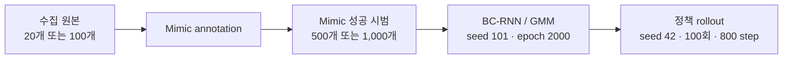

# Agibot Toy2Box 모방학습

**Agibot 오른팔로 트럭을 집어 상자 안에 놓는 정책**을 학습한다. 연구 축은 **조작자 1명 vs 다수**이며, New rule의 단일 수집 구성과 여러 출처의 자료를 혼합한 Multi operator를 비교한다. New rule 20개·100개 조건으로 원본 개수 차이도 함께 살펴본다. n100은 스크립트 테스트용으로 구분한다.

기본 선택 모델은 **new rule 원본 100개 → annotation 98개 → Mimic 1,000개 → epoch 2000**이다. 각 실험의 원본 HDF5와 rollout 모델을 공개했다. 
[문제·가설](docs/METHOD.md) · [실험 결과](docs/RESULTS.md) · [구현](docs/IMPLEMENTATION.md) · [재현 명령](docs/REPRODUCE.md) · [영상](docs/MEDIA.md)

## 정책 동작: 수집 조건별 rollout

| New rule · 원본 20개 | New rule · 원본 100개 |
| --- | --- |
| [](videos/experiments/new_rule_20/rollout-episode-0.mp4) | [](videos/experiments/new_rule_100/rollout-episode-0.mp4) |
| **회전 → XY → 하강 · Mimic 1,000개** | **회전 → XY → 하강 · Mimic 1,000개** |

| Multi operator · 원본 100개 |
| --- |
| [](videos/experiments/multi_operator_100/rollout-episode-0.mp4) |
| **수집 파일 5개 병합 · Mimic 1,000개** |


## 1. 연구 축: 조작자 1명 vs 다수

**연구 질문:** 한 명의 조작자에 해당하는 단일 조건과 여러 조작자의 자료를 혼합한 조건으로 학습했을 때 정책 성능이 달라지는가?

현재는 New rule을 단일 수집 구성의 비교 기준으로, Multi operator를 다수 출처의 혼합 조건으로 둔다. 두 조건의 원본 100개·Mimic 1,000개를 맞춰 비교하고, New rule 20개는 원본 개수에 대한 보조 조건으로 사용한다.

**다수 조건에 사용한 데이터:** new_rule, vertical, 팀원 1, 팀원 2, 조교님 데이터. 각각 20개씩, 총 100개로 구성했다.

| 가설 | 비교한 조건 | 해석할 때 맞춰야 할 조건 |
| --- | --- | --- |
| 같은 규칙에서 원본 시범을 늘리면 더 다양한 상태를 다룰 수 있다 | New rule 20과 100 | 두 조건 모두 Mimic 1,000개; 원본의 궤적 중복 확인 |
| 여러 수집 파일을 섞으면 다양성과 일관성이 함께 달라진다 | New rule 100과 Multi operator | 실제 수집자 정보, 접근 순서, idle 차이를 구분 |

학습 seed 101 한 개를 사용한 비교다. 연구 조건은 각각 Mimic 1,000개를 사용한다.

## 2. 수집 원본에서 학습 정책까지



| 조건 | 용도 | 수집 원본 | Annotation | Mimic 학습 시범 |
| --- | --- | ---: | ---: | ---: |
| New rule 20 | 연구 비교 | 20 | 19 | 1,000 |
| New rule 100 | 연구 비교 | 100 | 98 | 1,000 |
| Multi operator | 연구 비교 | 100 | 93 | 1,000 |


## 3. 동작 순서와 정책 구현

| 구성 | 접근 순서 | 공통 후속 동작 |
| --- | --- | --- |
| New rule | 회전으로 수직 파지 자세 맞추기 → XY 이동 → 수직 하강 | 그립 → 충분히 상승 → 박스 이동 → 릴리즈 |
| Multi operator | new_rule·vertical·팀원 1·팀원 2·조교님 데이터 혼합 | 각 20개, 원본별 경로·정지 구성 유지 |


## 4. 데이터 특성과 확인된 결과


그림은 **수집 원본의 통계**다. idle은 각 episode에서 이동·회전 action 6개가 모두 정확히 0인 프레임의 비율을 계산한 뒤 평균했다. 그리퍼 값은 제외한다. 정책 성공률을 나타내는 그림이 아니다.

| 실험 | 원본 평균 길이 | 원본 idle 평균 | 정확한 정책 성공률 |
| --- | ---: | ---: | --- |
| New rule 20 | 32.81초 | 20.23% | 0.55 |
| New rule 100 | 32.20초 | 20.08% | 0.62 |
| Multi operator | 34.16초 | 27.41% | 0.32 |

[상세 결과와 영상 점검](docs/RESULTS.md) · [요약 CSV](results/experiment_summary.csv) · [원자료와 검증 기록](reports) · [원본 데이터·모델 SHA256](manifest.json)

## 5. 공개 원본 HDF5와 rollout 모델

| 실험 | 원본 HDF5 | Rollout 모델 |
| --- | --- | --- |
| New rule 20 | [20개 원본](https://github.com/Kim-KiSuk/Robotics-Simulation-Assignmnet2/releases/download/experiments-2026-11-01/toy2box_new_rule_20.hdf5) | [epoch 2000](https://github.com/Kim-KiSuk/Robotics-Simulation-Assignmnet2/releases/download/experiments-2026-11-01/toy2box_new_rule_20_epoch2000.pth) |
| New rule 100 | [100개 원본](https://github.com/Kim-KiSuk/Robotics-Simulation-Assignmnet2/releases/download/experiments-2026-11-01/toy2box_new_rule_100.hdf5) | [epoch 2000](https://github.com/Kim-KiSuk/Robotics-Simulation-Assignmnet2/releases/download/experiments-2026-11-01/toy2box_new_rule_100_epoch2000.pth) |
| Multi operator | [100개 원본](https://github.com/Kim-KiSuk/Robotics-Simulation-Assignmnet2/releases/download/experiments-2026-11-01/toy2box_multi_operator_100.hdf5) | [epoch 2000](https://github.com/Kim-KiSuk/Robotics-Simulation-Assignmnet2/releases/download/experiments-2026-11-01/toy2box_multi_operator_100_epoch2000.pth) |


기본 선택 가중치 [models/final_model.pth](models/final_model.pth)는 New rule 100의 모델이다. 모든 모델은 학습 seed 101, epoch 2000이며, 선택 기준은 고정 epoch다.

## 6. 평가 명령어와 재현

이 저장소는 **문서·모델·과업 코드와 공개 자료를 모은 배포 저장소**다. 실행에는 Isaac Sim, Toy2Box 로봇·물체 자산과 IsaacLab_RS가 설치된 `lerobot-arena` 환경이 필요하다. 포함한 `isaaclab_project/`는 해당 설치에 적용하는 과업 코드이며 시뮬레이터 엔진 전체를 포함하지 않는다.

아래는 저장소 다운로드 → 과업 코드 적용 → 기본 모델 100회 평가 순서다. 기존 설치 경로가 다르면 `--isaaclab_root`를 바꾼다. 코드 적용 도구는 변경할 원본을 백업한다.

```bash
conda activate lerobot-arena
git clone https://github.com/Kim-KiSuk/Robotics-Simulation-Assignmnet2.git
cd Robotics-Simulation-Assignmnet2

python tools/install_project_overlay.py \
  --isaaclab_root "$HOME/IsaacLab_RS" --apply

python tools/evaluate_experiment.py \
  --isaaclab_root "$HOME/IsaacLab_RS" \
  --experiment new_rule_100 \
  --num_rollouts 100 --horizon 800 --seed 42 \
  --output_root ./results/evaluations \
  --headless --video
```

이미 clone했거나 Download ZIP을 푼 경우에는 해당 저장소 폴더로 이동해 실행한다. 결과는 `results/evaluations/<실험ID>_<실행시각>/`의 명령·모델 해시·전체 로그·rollout별 판정 JSON으로 저장된다. 다른 실험 모델은 Release에서 내려받은 뒤 같은 평가 도구의 `--experiment`만 바꿔 비교한다.

[제출용 평가 명령 TXT](submission/evaluation_command.txt) · [평가만 실행](submission/evaluation_only.txt) · [설치·학습·다운로드 상세](docs/REPRODUCE.md)


## 참고

[IsaacLab_RS 고정 원본](https://github.com/cailab-hy/IsaacLab_RS/tree/e83a5d2f11ca1b5f03b690e1978479e620c500e2)과 [Isaac Lab](https://github.com/isaac-sim/IsaacLab)을 기반으로 한다. [출처·라이선스](THIRD_PARTY_NOTICES.md)
