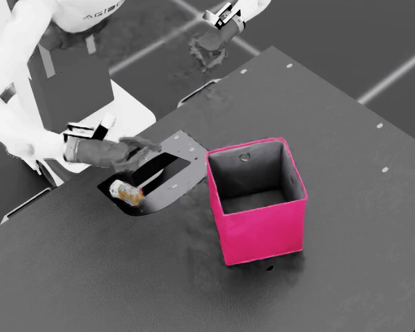
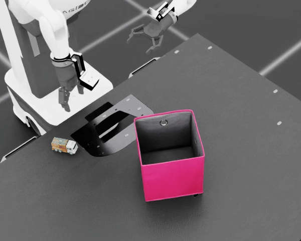
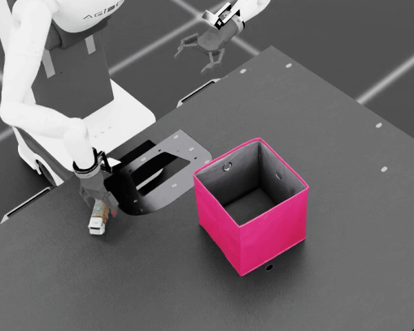
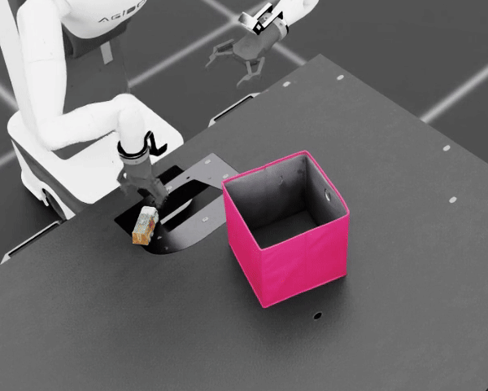
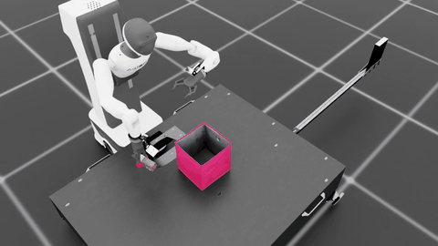
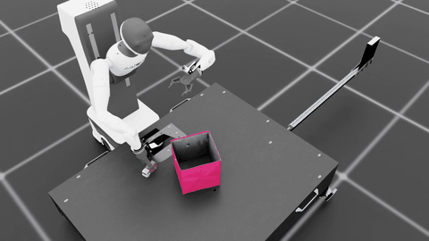
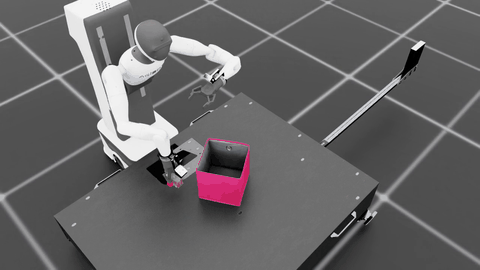
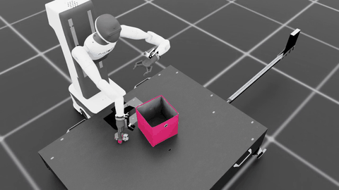

# Agibot Toy2Box 모방학습

**Agibot 오른팔로 트럭을 집어 상자 안에 놓는 정책**을 학습한다. 주된 연구 질문은 **조작자 1명과 다수의 시범으로 학습한 정책의 성능이 다른가**이다. 단일 실험과 혼합 실험을 각각 구성해 사용자 구성에 따른 차이를 비교했다.

원본 시범은 조건마다 **20개**, Mimic 성공 시범은 **500개**로 맞췄다. 학습 seed **101·111** 모델을 각각 평가한 결과, 평균 성공률은 **① 단일 사용자·단일 실험 30.5%, ② 단일 사용자·혼합 실험 43.5%, ③ 다수 사용자·단일 실험 30.0%, ④ 다수 사용자·혼합 실험 38.0%**였다.

**핵심 관찰:** 원본 시범 20개 규모에서도 혼합 실험의 평균 성공률이 두 사용자 구성에서 모두 높았다. 이는 이번 조건에서 **단일 행동 패턴의 일관성을 유지하는 것보다 시범 유형의 다양성을 확보하는 것이 더 유리할 수 있다**는 결과 기반 가설을 뒷받침한다.

## 1. 실험 구성

| 조건 | 사용자 구성 | 원본 시범 구성 | 원본 수 | Mimic 성공 시범 |
| --- | --- | --- | ---: | ---: |
| ① 단일 사용자·단일 실험 | 본인 1명 | S1 20개 | 20 | 500 |
| ② 단일 사용자·혼합 실험 | ①과 같은 본인 1명 | S1 10개 + S2 10개 | 20 | 500 |
| ③ 다수 사용자·단일 실험 | 본인 포함 5명, 각 4개 | 전부 S1 | 20 | 500 |
| ④ 다수 사용자·혼합 실험 | ③과 같은 5명, 각 4개 | 각자 S1 2개 + S2 2개 | 20 | 500 |

**단일 실험**은 S1 시범만 사용한 조건이고, **혼합 실험**은 S1·S2 시범을 같은 비율로 합친 조건이다. 혼합 실험도 전체 시범 수는 20개로 유지한다.

| 시범 유형 | 동작 규칙 |
| --- | --- |
| S1 | **회전 → XY 이동 → 수직 하강 → 그립 → 수직 상승 → 박스 이동 → 릴리즈** |
| S2 | **XY 이동 → 회전 → 수직 하강 → 그립 → 수직 상승 → 박스 이동 → 릴리즈** |

두 유형 모두 수직 파지를 기준으로 한다. S2에서는 회전 뒤 필요한 경우 XY 위치를 재정렬한다.

사용자 구성은 **①↔③**, **②↔④**로 비교한다. 같은 사용자 구성에서 시범 혼합에 따른 차이는 **①↔②**, **③↔④**로 확인한다.

## 2. 평가 결과

평가 seed는 **42**, 모델마다 **100회 rollout**, 한도는 **800 step**이다. 1 step은 0.05초이므로 최대 40초다. 아래 성공률은 전달받은 평가 종료 집계값이며, 평균과 표준편차는 학습 seed 101·111의 두 성공률에서 계산했다.

| 조건 | 학습 seed 101 성공률 | 학습 seed 111 성공률 | 평균 ± 표준편차 | 평가 seed |
| --- | ---: | ---: | ---: | ---: |
| ① 단일 사용자·단일 실험 | 30% (30/100) | 31% (31/100) | **30.5% ± 0.71%p** | **42** |
| ② 단일 사용자·혼합 실험 | 43% (43/100) | 44% (44/100) | **43.5% ± 0.71%p** | **42** |
| ③ 다수 사용자·단일 실험 | 32% (32/100) | 28% (28/100) | **30.0% ± 2.83%p** | **42** |
| ④ 다수 사용자·혼합 실험 | 32% (32/100) | 44% (44/100) | **38.0% ± 8.49%p** | **42** |

표준편차는 두 학습 seed를 표본으로 계산한 **표본 표준편차(n−1)**다. 평가 성공률의 신뢰구간이나 rollout 간 표준편차를 뜻하지 않는다. 총 8개 모델을 각각 100회 평가했다.

| 비교 | 평균 성공률 차이 | 관찰 |
| --- | ---: | --- |
| 단일 사용자에서 혼합 비교 · ②−① | **+13.0%p** | 두 seed 모두 혼합 실험이 13%p 높았다. |
| 다수 사용자에서 혼합 비교 · ④−③ | **+8.0%p** | seed 101은 차이가 없었고, seed 111은 혼합 실험이 16%p 높았다. |
| 단일 실험에서 사용자 구성 · ①−③ | **+0.5%p** | 평균은 비슷했고, seed별 우열이 달랐다. |
| 혼합 실험에서 사용자 구성 · ②−④ | **+5.5%p** | seed 101은 단일 사용자가 11%p 높았고, seed 111은 같았다. |
| 전체 구성 비교 · ①↔④ (④−①) | **+7.5%p** | ④가 seed 101에서 2%p, seed 111에서 13%p 높았다. |
| 전체 구성 비교 · ②↔③ (②−③) | **+13.5%p** | ②가 seed 101에서 11%p, seed 111에서 16%p 높았다. |

①↔④와 ②↔③은 **사용자 구성과 시범 혼합 여부가 동시에 다른 전체 구성 간 비교**다. 이 두 비교의 차이를 사용자 수 또는 시범 혼합 중 한 요인의 효과로 분리해 해석하지 않는다.

### 실패 단계별 분석

8개 모델의 평가 영상 800개에 대한 분류를 함께 정리했다. 영상상 성공으로 분류한 284개를 제외한 **516개**를 접근·파지·운반·배치 단계로 나눴다. 아래 횟수는 각 단계의 분류 수이며, **괄호는 해당 행의 실패 분류 수를 분모로 한 비율**이다. 조건별 집계는 학습 seed 101·111을 합친 200회다.

| 구분 | 평가 수 | 실패 분류 수 | 접근 | 파지 | 운반 | 배치 |
| --- | ---: | ---: | ---: | ---: | ---: | ---: |
| ① 단일 사용자·단일 실험 | 200 | 139 | 22 (15.8%) | 64 (46.0%) | 17 (12.2%) | 36 (25.9%) |
| ② 단일 사용자·혼합 실험 | 200 | 113 | 12 (10.6%) | 55 (48.7%) | 9 (8.0%) | 37 (32.7%) |
| ③ 다수 사용자·단일 실험 | 200 | 140 | 18 (12.9%) | 62 (44.3%) | 10 (7.1%) | 50 (35.7%) |
| ④ 다수 사용자·혼합 실험 | 200 | 124 | 23 (18.5%) | 70 (56.5%) | 7 (5.6%) | 24 (19.4%) |
| 전체 | 800 | 516 | 75 (14.5%) | 251 (48.6%) | 43 (8.3%) | 147 (28.5%) |

분류 기준은 다음과 같다.

| 단계 | 관찰 기준 |
| --- | --- |
| 접근 | 물체까지 접근하지 못하거나 위치가 어긋난 채 머무름. |
| 파지 | 물체를 잡으려 하지만 안정적으로 들어 올리지 못함. |
| 운반 | 물체를 들어 이동했으나 상자 입구에 도달하지 못하거나 이동 중 놓침. |
| 배치 | 상자 입구까지 가져왔으나 놓지 못하거나 가장자리·바깥에 놓음. |

**파지는 전체 실패 분류의 48.6%로 가장 큰 비중**을 차지했다. 다만 혼합 실험의 성능 차이가 모든 실패 단계에서 같은 방향으로 나타난 것은 아니다. 단일 사용자에서는 ①→②로 바뀔 때 접근 22→12회, 파지 64→55회, 운반 17→9회로 줄었지만 배치는 36→37회로 비슷했다. 다수 사용자에서는 ③→④의 배치 분류가 50→24회로 줄었지만 파지는 62→70회로 늘었다. 이 횟수 비교는 각 조건 200회 기준이며, 실패만을 분모로 한 비율 변화와 구분한다.

이 결과는 혼합 실험의 높은 평균 성공률과 함께 참고할 수 있는 행동 관찰이다. 시범 다양성이 특정 단계의 문제를 해결했다고 인과적으로 확정하지 않는다. 아래 GIF는 각 단계가 보이는 대표 예시다.


**집계 해석:** 각 실패 비율의 분모는 전체 800회가 아니라 실패로 분류한 516회다. 전체 800회 기준 접근은 9.38%, 파지는 31.38%, 운반은 5.38%, 배치는 18.38%이며, 영상상 성공 분류는 35.50%다. 반올림으로 비율 합계가 100%와 조금 다를 수 있다.


### 실패 단계별 대표 예시

GIF는 작업 영역을 확대한 **원본 속도 1배속의 관찰 구간**이다. 전체 에피소드가 아니며, 원본 시간 범위를 각 예시에 표시했다. 

| 접근 | 파지 |
| --- | --- |
|  |  |
| **④ · 학습 seed 111 · Trial 16 · 0–10초**<br>물체까지 내려가지 못하고 위에서 머묾. | **① · 학습 seed 101 · Trial 1 · 9–20초**<br>물체를 밀고 기울인 뒤 빈손으로 올라감. |

| 운반 | 배치 |
| --- | --- |
|  |  |
| **④ · 학습 seed 111 · Trial 12 · 23–38초**<br>들어 올린 물체를 상자 밖에서 놓침. | **④ · 학습 seed 111 · Trial 36 · 12–25초**<br>상자까지 가져왔지만 계속 잡고 있음. |

모두 평가 seed **42**다. 반복 재생 때 마지막에서 처음으로 돌아가는 것은 GIF 재생 동작이다.

## 3. 초기 가설과 실험 결과 해석

**초기 가설**

원본 시범이 20개로 제한된 조건에서는 행동 패턴의 일관성이 학습에 유리할 것으로 예상했다. 따라서 **단일 실험이 혼합 실험보다, 단일 사용자가 다수 사용자보다 높은 성공률을 보일 것**으로 가정했다.

**실험 결과와 가설 검토**

혼합 실험의 평균 성공률은 단일 사용자에서 **30.5% → 43.5% (+13%p)**, 다수 사용자에서 **30.0% → 38.0% (+8%p)**로 높아졌다. 따라서 단일 행동 패턴을 유지하는 것이 더 유리할 것이라는 초기 예상은 이번 결과에서 지지되지 않았다. 특히 단일 사용자는 두 학습 seed 모두 혼합 실험이 13%p 높았다.

사용자 수에 따른 차이는 단일 실험에서 **단일 사용자가 0.5%p**, 혼합 실험에서 **5.5%p** 높았다. 평균은 초기 예상과 같은 방향이지만, 단일 실험에서는 seed별 우열이 달랐고 혼합 실험에서는 seed 111의 성공률이 같았다. 따라서 단일 사용자의 뚜렷한 우세를 확인했다고 해석하기 어렵다.

**결과 해석**

원본 시범 수를 늘리지 않고 S1·S2를 균형 있게 섞은 조건에서 더 높은 평균 성능이 관찰됐다. 서로 다른 접근 자세와 경로가 정책이 접하는 상태를 넓혔을 가능성이 있다. 다만 시범 유형의 혼합이 상태 다양성을 얼마나 늘렸는지는 별도로 측정하지 않았다. S2 시범 자체의 난이도, 완료 시간, 파지 위치도 영향을 줄 수 있어 성능 차이의 원인을 다양성 하나로 확정하지 않는다.

**결과에서 도출한 후속 가설**

> 원본 시범이 20개인 소규모 조건에서도, 하나의 행동 패턴을 반복하는 것보다 서로 다른 시범 유형을 균형 있게 포함하는 것이 정책 학습에 더 유리할 수 있다.

이 후속 가설은 실험 결과를 바탕으로 제시한 것이며, 초기 가설과 구분한다. 여기서 다양성은 **S1·S2 시범 유형의 혼합**을 뜻하며, 사용자 수를 늘리는 것과 같은 개념으로 해석하지 않는다.

**해석 범위**

학습 seed는 2개이고, 다수 사용자 혼합 실험은 seed별 32%·44%로 변동이 컸다. 따라서 이번 결론은 **원본 20개·Mimic 500개 조건에서 혼합 시범의 평균 성능이 높았으며, 시범 유형의 다양성이 도움이 될 가능성을 시사한다**로 한정한다. 다양성이 일관성보다 중요하다는 일반적 명제나 통계적 유의성을 입증한 결과로 제시하지 않는다.

## 4. 조교님 기준과의 비교

수업에서 제공된 조교님 기준은 **원본 시범 20개 → Mimic 500개 → 정책 평가 100회**, 성공률 **26% (26/100)**다. 평가 seed 42·horizon 800·epoch 2000은 이번 실험과 같다. 다만 공개된 26%는 하나의 평가 집계이며, 학습 seed 101·111의 평균과 표준편차가 제공된 결과는 아니다.

| 비교 대상 | 원본 / Mimic | 성공률 | 평가 seed | 집계 방식 |
| --- | --- | ---: | ---: | --- |
| 조교님 제공 기준 | 20 / 500 | **26% (26/100)** | **42** | 공개된 단일 모델 평가 결과 |
| ① 단일 사용자·단일 실험 | 20 / 500 | **30.5% ± 0.71%p** | **42** | 학습 seed 101·111의 평균 ± 표본 표준편차 |
| ② 단일 사용자·혼합 실험 | 20 / 500 | **43.5% ± 0.71%p** | **42** | 학습 seed 101·111의 평균 ± 표본 표준편차 |
| ③ 다수 사용자·단일 실험 | 20 / 500 | **30.0% ± 2.83%p** | **42** | 학습 seed 101·111의 평균 ± 표본 표준편차 |
| ④ 다수 사용자·혼합 실험 | 20 / 500 | **38.0% ± 8.49%p** | **42** | 학습 seed 101·111의 평균 ± 표본 표준편차 |
| 조교님 데이터 재현 대조군 | 20 / 500 | **33.5% ± 4.95%p** | **42** | 학습 seed 101·111의 평균 ± 표본 표준편차 |

현재 네 조건의 평균은 제공 기준 26%보다 높지만, 단일 공개 결과와 두 seed 평균의 차이만으로 성능 개선을 확정하지 않는다. 사용자 구성과 혼합 여부에 관한 비교는 ①~④끼리 수행하고, 조교님 데이터는 별도의 기준선으로 둔다.

**동일 조건의 재현 비교 절차**

1. 조교님 원본 시범 20개를 annotation하고, 기존 네 조건과 같은 Mimic 생성 설정으로 성공 시범 500개를 준비한다.
2. 이 500개를 공통 입력으로 사용해 학습 seed **101·111을 각각 학습**한다. 모델·epoch·batch 등은 기존 네 조건과 맞춘다.
3. 두 모델을 각각 **평가 seed 42·100회 rollout·horizon 800**으로 평가하고, 평균 ± 표본 표준편차를 위 표에 추가한다.

Mimic 데이터는 한 번 준비해 두 학습에 함께 사용한다. 제공된 26%를 재현 대조군의 실측값으로 대신 쓰지 않는다.

## 5. 공통 조건과 학습 입력

| 항목 | 설정 |
| --- | --- |
| Task | `Isaac-Place-Toy2Box-Agibot-Right-Arm-RmpFlow-v0` |
| 환경·성공 판정·종료 조건 | 조건 간 동일 |
| 원본 / Mimic 성공 시범 | 조건마다 20개 / 500개 |
| 정책 | BC-RNN / GMM |
| LSTM / GMM | hidden 400 · 2 layers / 5 modes |
| 관측 / 행동 | 23차원 / 7차원 |
| Sequence / batch | 10 / 100 |
| 학습률 / epoch | 0.001 / 2000 |
| 학습 seed | 101, 111 |
| 평가 seed / rollout / horizon | 42 / 모델마다 100회 / 800 step |

8개 모델의 저장된 학습 설정에서 알고리즘·관측 설정과 epoch·batch·sequence가 같은 것을 확인했다. 학습 로그에서 각 조건의 입력 시범 수를, 실행 기록에서 평가 seed·rollout·horizon을 확인했다.

| 조건 | 학습에 사용한 Mimic 파일 |
| --- | --- |
| ① | `toy2box_agibot_mimic_c1_20_500.hdf5` |
| ② | `toy2box_agibot_mimic_c2_20_500.hdf5` |
| ③ | `toy2box_agibot_mimic_c3_20_500.hdf5` |
| ④ | `toy2box_agibot_mimic_c4_20_500.hdf5` |

위 Mimic 500개 파일은 별도로 준비하는 학습 입력이며, 저장소의 원본 시범 20개 HDF5와 구분한다. 아래는 평균 성공률이 가장 높은 **② 단일 사용자·혼합 실험**을 학습하는 예시다. 학습 seed는 과업 설정 JSON의 `train.seed`에서 지정한다.

```bash
./isaaclab.sh -p scripts/imitation_learning/robomimic/train.py \
    --task Isaac-Place-Toy2Box-Agibot-Right-Arm-RmpFlow-v0 \
    --algo bc \
    --dataset ./datasets/toy2box_agibot_mimic_c2_20_500.hdf5
```

seed별 결과와 계산값은 `results/experiment_results.json`에 저장했다.

## 6. 최종 데이터셋과 모델

조건별 원본 시범 20개와 **② 단일 사용자·혼합 실험의 최종 모델 2개**를 저장소에 포함했다. 제공 모델은 **epoch 2000 · 학습 seed 101·111**이며, 파일명에 조건 번호와 학습 seed를 표시했다.

| 조건 | 원본 데이터셋 · 각 20개 | 학습 seed 101 모델 | 학습 seed 111 모델 |
| --- | --- | --- | --- |
| ① 단일 사용자·단일 실험 | [toy2box_agibot_c1.hdf5](datasets/toy2box_agibot_c1.hdf5) | — | — |
| ② 단일 사용자·혼합 실험 | [toy2box_agibot_c2.hdf5](datasets/toy2box_agibot_c2.hdf5) | [c2 · seed 101](models/toy2box_agibot_c2_seed101.pth) | [c2 · seed 111](models/toy2box_agibot_c2_seed111.pth) |
| ③ 다수 사용자·단일 실험 | [toy2box_agibot_c3.hdf5](datasets/toy2box_agibot_c3.hdf5) | — | — |
| ④ 다수 사용자·혼합 실험 | [toy2box_agibot_c4.hdf5](datasets/toy2box_agibot_c4.hdf5) | — | — |

HDF5는 수집 원본이며, 학습에는 원본을 annotation한 뒤 생성한 Mimic 500개를 사용했다. 공개 원본은 로컬 출처 경로만 익명 식별자로 바꾸고 관측·행동·초기 상태 배열은 유지했다. 제공하는 두 모델은 평가한 checkpoint 그대로다. 파일 크기와 SHA-256은 `results/experiment_results.json`에 기록했다.

## 7. 정책 성공 예시

상자 투입과 그리퍼 릴리즈가 영상에서 확인되는 예시를 **조건별 한 개씩** 골랐다. 모두 **학습 seed 101·평가 seed 42** 모델의 영상이다. GIF는 마지막 6초를 원래 속도로 보여주며, 클릭하면 전체 MP4로 이동한다.

| ① 단일 사용자·단일 실험 | ② 단일 사용자·혼합 실험 |
| --- | --- |
| [](videos/toy2box_agibot_c1_success.mp4) | [](videos/toy2box_agibot_c2_success.mp4) |
| **Trial 17 · 전체 19.90초 · 평가 seed 42** | **Trial 35 · 전체 15.00초 · 평가 seed 42** |

| ③ 다수 사용자·단일 실험 | ④ 다수 사용자·혼합 실험 |
| --- | --- |
| [](videos/toy2box_agibot_c3_success.mp4) | [](videos/toy2box_agibot_c4_success.mp4) |
| **Trial 99 · 전체 23.45초 · 평가 seed 42** | **Trial 29 · 전체 14.85초 · 평가 seed 42** |

## 8. 프로젝트 실행

실행 기준은 네 조건 중 평균 성공률이 가장 높은 **② 단일 사용자·혼합 실험(43.5% ± 0.71%p)**이다. 원본 데이터셋은 `datasets/toy2box_agibot_c2.hdf5`이며, 아래에 해당 조건의 학습 seed **101·111 최종 모델** 평가 명령을 각각 제시한다.

Isaac Sim과 Toy2Box 자산이 설치된 수업용 `lerobot-arena` 환경을 사용한다. 이 저장소 자체가 IsaacLab_RS 프로젝트이며 `source/`, `scripts/`, `isaaclab.sh`, `datasets/`, `models/`, `videos/`를 포함한다. Isaac Sim 엔진과 외부 자산은 별도 설치한다.

```bash
conda activate lerobot-arena
cd ~
git clone https://github.com/Kim-KiSuk/Robotics-Simulation_Assignment2.git
cd ~/Robotics-Simulation_Assignment2
```

수업 환경에 설치된 의존성을 유지하면서 현재 프로젝트의 Python 패키지 경로를 등록한다.

```bash
./isaaclab.sh -p -m pip install --no-deps \
    -e source/isaaclab \
    -e source/isaaclab_assets \
    -e source/isaaclab_tasks \
    -e source/isaaclab_mimic
```

학습 명령은 과업에 등록된 설정을 읽는다. 학습 seed는 아래 JSON의 `train.seed`에서 지정한다.

```text
source/isaaclab_tasks/isaaclab_tasks/manager_based/manipulation/place/config/agibot/agents/robomimic/bc_rnn_low_dim.json
```

**정책 평가:** 두 모델 모두 epoch **2000** 최종본이다. 평가 조건은 seed **42**·100회 rollout·horizon **800**으로 동일하게 맞춘다.

**학습 seed 101 모델 — 성공률 43% (43/100)**

```bash
./isaaclab.sh -p scripts/imitation_learning/robomimic/play.py \
    --task Isaac-Place-Toy2Box-Agibot-Right-Arm-RmpFlow-v0 \
    --checkpoint ./models/toy2box_agibot_c2_seed101.pth \
    --num_rollouts 100 \
    --horizon 800 \
    --seed 42 \
    --video \
    --video_length 1000 \
    --video_folder ./videos/toy2box_agibot_c2_seed101 \
    --headless
```

**학습 seed 111 모델 — 성공률 44% (44/100)**

```bash
./isaaclab.sh -p scripts/imitation_learning/robomimic/play.py \
    --task Isaac-Place-Toy2Box-Agibot-Right-Arm-RmpFlow-v0 \
    --checkpoint ./models/toy2box_agibot_c2_seed111.pth \
    --num_rollouts 100 \
    --horizon 800 \
    --seed 42 \
    --video \
    --video_length 1000 \
    --video_folder ./videos/toy2box_agibot_c2_seed111 \
    --headless
```

두 명령의 `--seed 42`는 **평가 seed**다. 학습 seed 101·111은 각각의 checkpoint로 구분하며, 영상 저장 폴더도 별도로 사용한다.

## 참고

[IsaacLab_RS](https://github.com/cailab-hy/IsaacLab_RS)와 [Isaac Lab](https://github.com/isaac-sim/IsaacLab)을 기반으로 한다. [라이선스](LICENSE)
