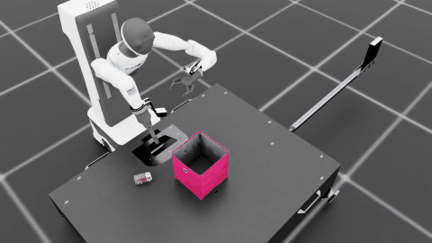
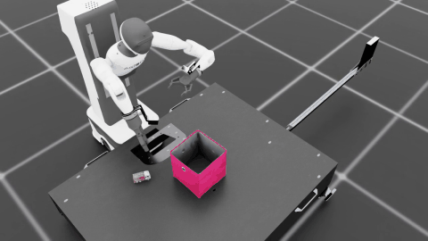
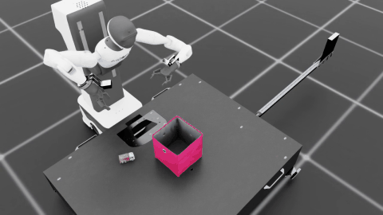
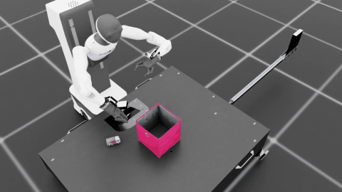
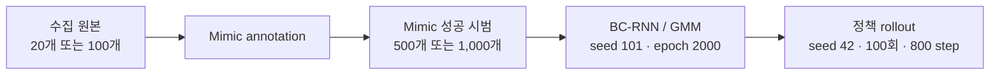

# Agibot Toy2Box 모방학습

**Agibot 오른팔로 트럭을 집어 상자 안에 놓는 정책**을 학습한다. 시범의 동작 순서, 원본 개수, 여러 수집 파일의 혼합이 BC 정책에 어떤 영향을 주는지 비교했다. 수집 원본을 Mimic으로 증강하고, 같은 BC-RNN/GMM 구조로 다섯 실험을 학습했다.

기본 선택 모델은 **new rule 원본 100개 → annotation 98개 → Mimic 1,000개 → epoch 2000**이다. 각 실험의 원본 HDF5와 rollout 모델을 공개했다. **정확한 정책 성공률은 기존 평가 출력 미확보로 아직 미확정**이며, 영상 길이를 성공률로 사용하지 않는다.

[문제·가설](docs/METHOD.md) · [실험 결과](docs/RESULTS.md) · [구현](docs/IMPLEMENTATION.md) · [재현 명령](docs/REPRODUCE.md) · [영상](docs/MEDIA.md)

## 정책 동작: 수집 조건별 rollout

이미지는 **실제 Isaac Sim 정책 영상의 8~14초 구간을 원래 속도로** 반복한다. 클릭하면 전체 MP4로 이동한다. 모든 미리보기는 trial 0의 같은 시간 구간이며, 성공 여부에 따라 고르지 않았다. 동작 참고 영상과 100회 평가 통계는 구분한다.

| New rule · 원본 20개 | New rule · 원본 100개 |
| --- | --- |
| [](videos/experiments/new_rule_20/rollout-episode-0.mp4) | [](videos/experiments/new_rule_100/rollout-episode-0.mp4) |
| **회전 → XY → 하강 · Mimic 1,000개** | **회전 → XY → 하강 · Mimic 1,000개** |

| Vertical · 원본 20개 | Multi operator · 원본 100개 |
| --- | --- |
| [](videos/experiments/xy_first_20/rollout-episode-0.mp4) | [](videos/experiments/multi_operator_100/rollout-episode-0.mp4) |
| **XY → 회전 → 하강 · Mimic 1,000개** | **수집 파일 5개 병합 · Mimic 1,000개** |

n100의 원본과 모델도 아래 Release에 제공한다. 영상과 checkpoint의 연결 근거, 원본 action 재생 영상은 [영상 안내](docs/MEDIA.md)에 정리했다.

## 1. 무엇을 확인하려 했는가?

같은 물체를 옮기는 시범도 회전 시점, 접근 경로, 정지 시간이 다를 수 있다. 우리는 **동작 순서의 일관성, 원본 시범의 양, 수집 구성의 다양성**을 비교 대상으로 삼았다.

| 가설 | 비교한 조건 | 해석할 때 맞춰야 할 조건 |
| --- | --- | --- |
| 접근 순서가 일정하면 행동을 학습하기 쉬울 수 있다 | New rule과 Vertical | 원본 수·증강 수·학습 설정을 함께 확인 |
| 같은 규칙에서 원본 시범을 늘리면 더 다양한 상태를 다룰 수 있다 | New rule 20과 100 | 두 조건 모두 Mimic 1,000개; 원본의 궤적 중복 확인 |
| 여러 수집 파일을 섞으면 다양성과 일관성이 함께 달라진다 | New rule 100과 Multi operator | 실제 수집자 정보, 접근 순서, idle 차이를 구분 |

학습 seed 101 한 개를 사용한 비교다. n100은 Mimic 500개, 나머지는 1,000개이므로 규칙 하나의 효과로 결과를 해석할 수 없다. 파일 5개가 서로 다른 사람 5명을 의미하는지도 별도로 확인해야 한다. [통제 조건과 검증 범위](docs/METHOD.md)

## 2. 수집 원본에서 학습 정책까지



| 실험 | 수집 원본 | Annotation | Mimic 학습 시범 | 학습 run |
| --- | ---: | ---: | ---: | --- |
| n100 | 100 | 99 | 500 | `20261027100809` |
| New rule 20 | 20 | 19 | 1,000 | `20261029111434` |
| New rule 100 | 100 | 98 | 1,000 | `20261101015656` |
| Vertical | 20 | 20 | 1,000 | `20261029203527` |
| Multi operator | 100 | 93 | 1,000 | `20261031151706` |

원본은 실제 수집한 개수를 유지했다. **원본 20개는 20개로, 원본 100개는 100개로 공개**하며 annotation·Mimic 파일이나 중간 epoch 가중치는 배포에 포함하지 않는다. [원본/모델 대응](reports/original_rollout_pairs.json)

## 3. 동작 순서와 정책 구현

| 구성 | 접근 순서 | 공통 후속 동작 |
| --- | --- | --- |
| New rule | 회전으로 수직 파지 자세 맞추기 → XY 이동 → 수직 하강 | 그립 → 충분히 상승 → 박스 이동 → 릴리즈 |
| Vertical | XY 이동 → 회전 → 수직 하강 | 그립 → 충분히 상승 → 박스 이동 → 릴리즈 |
| Multi operator | 서로 다른 수집 원본 파일 5개를 병합 | 원본별 경로·정지 구성 유지 |

수집기는 물체를 실제로 들어 올렸는지와 박스 입구 정렬·릴리즈를 확인한다. 성공·실패 후에는 장면과 기록 버퍼를 리셋한다. 속도 변화와 분산 멈춤을 사용한 조건의 목표 idle은 21%다.

정책 입력은 **23차원 상태**, 출력은 **상대 이동 3축 + 회전 3축 + 그리퍼의 7차원 action**이다. BC-RNN은 LSTM hidden 400·2 layers, GMM 5 modes, sequence length 10을 사용한다. 두 보조 뷰는 조작 화면이며 원본 HDF5에 저장된 RGB 관측이 아니다. [관측·제어·수집 코드](docs/IMPLEMENTATION.md)

## 4. 데이터 특성과 확인된 결과


그림은 **수집 원본의 통계**다. idle은 각 episode에서 이동·회전 action 6개가 모두 정확히 0인 프레임의 비율을 계산한 뒤 평균했다. 그리퍼 값은 제외한다. 정책 성공률을 나타내는 그림이 아니다.

| 실험 | 원본 평균 길이 | 원본 idle 평균 | 저장 action 재생 검증 | 정확한 정책 성공률 |
| --- | ---: | ---: | ---: | --- |
| n100 | 14.61초 | 0.70% | 전체 집계 없음 | 미확정 |
| New rule 20 | 32.81초 | 20.23% | 20 / 20 | 미확정 |
| New rule 100 | 32.20초 | 20.08% | 100 / 100 | 미확정 |
| Vertical | 35.63초 | 20.33% | 20 / 20 | 미확정 |
| Multi operator | 34.16초 | 27.41% | 91 / 100 | 미확정 |

재생 검증은 저장한 초기 상태와 action을 그대로 실행해 성공 조건을 10 step 연속 충족한 횟수다. 정책이 관측을 보고 행동을 새로 결정하는 독립 평가와 다르다. 현재 자료로 모델의 성능 순위나 조작자 수의 인과 효과를 확정하지 않는다.

New rule 20의 20개 궤적은 100개 원본에서도 action·EE 위치 지문이 일치했다. 두 조건의 원본이 독립적인 수집 표본이라고 간주하지 않는다. [궤적 중복 기록](results/data_overlap.json)

[상세 결과와 영상 점검](docs/RESULTS.md) · [요약 CSV](results/experiment_summary.csv) · [원자료와 검증 기록](reports) · [원본 데이터·모델 SHA256](manifest.json)

## 5. 공개 원본 HDF5와 rollout 모델

| 실험 | 원본 HDF5 | Rollout 모델 |
| --- | --- | --- |
| n100 | [100개 원본](https://github.com/Kim-KiSuk/Robotics-Simulation-Assignmnet2/releases/download/experiments-2026-11-01/toy2box_baseline_n100.hdf5) | [epoch 2000](https://github.com/Kim-KiSuk/Robotics-Simulation-Assignmnet2/releases/download/experiments-2026-11-01/toy2box_baseline_n100_epoch2000.pth) |
| New rule 20 | [20개 원본](https://github.com/Kim-KiSuk/Robotics-Simulation-Assignmnet2/releases/download/experiments-2026-11-01/toy2box_new_rule_20.hdf5) | [epoch 2000](https://github.com/Kim-KiSuk/Robotics-Simulation-Assignmnet2/releases/download/experiments-2026-11-01/toy2box_new_rule_20_epoch2000.pth) |
| New rule 100 | [100개 원본](https://github.com/Kim-KiSuk/Robotics-Simulation-Assignmnet2/releases/download/experiments-2026-11-01/toy2box_new_rule_100.hdf5) | [epoch 2000](https://github.com/Kim-KiSuk/Robotics-Simulation-Assignmnet2/releases/download/experiments-2026-11-01/toy2box_new_rule_100_epoch2000.pth) |
| Vertical | [20개 원본](https://github.com/Kim-KiSuk/Robotics-Simulation-Assignmnet2/releases/download/experiments-2026-11-01/toy2box_xy_first_20.hdf5) | [epoch 2000](https://github.com/Kim-KiSuk/Robotics-Simulation-Assignmnet2/releases/download/experiments-2026-11-01/toy2box_xy_first_20_epoch2000.pth) |
| Multi operator | [100개 원본](https://github.com/Kim-KiSuk/Robotics-Simulation-Assignmnet2/releases/download/experiments-2026-11-01/toy2box_multi_operator_100.hdf5) | [epoch 2000](https://github.com/Kim-KiSuk/Robotics-Simulation-Assignmnet2/releases/download/experiments-2026-11-01/toy2box_multi_operator_100_epoch2000.pth) |

[Release 전체·SHA256SUMS](https://github.com/Kim-KiSuk/Robotics-Simulation-Assignmnet2/releases/tag/experiments-2026-11-01) · [데이터 안내](artifacts/datasets/README.md) · [모델 안내](artifacts/checkpoints/README.md)

기본 선택 가중치 [models/final_model.pth](models/final_model.pth)는 New rule 100의 Release 모델과 바이트가 같다. 모든 모델은 학습 seed 101, epoch 2000이며, 선택 기준은 고정 epoch다. 평가로 최고 성능을 입증해 선택한 모델이라고 표기하지 않는다.

## 6. 평가 명령어와 재현

이 저장소는 **문서·모델·과업 코드와 공개 자료를 모은 배포 저장소**다. 실행에는 Isaac Sim, Toy2Box 로봇·물체 자산과 IsaacLab_RS가 설치된 `lerobot-arena` 환경이 필요하다. 포함한 `isaaclab_project/`는 해당 설치에 적용하는 과업 코드이며 시뮬레이터 엔진 전체를 포함하지 않는다.

아래는 저장소 다운로드 → 과업 코드 적용 → 기본 모델 100회 평가 순서다. 기존 설치 경로가 다르면 `--isaaclab_root`를 바꾼다. 코드 적용 도구는 변경할 원본을 백업한다.

```bash
conda activate lerobot-arena
git clone https://github.com/Kim-KiSuk/Robotics-Simulation-Assignmnet2.git
cd Robotics-Simulation-Assignmnet2

python tools/install_project_overlay.py \
  --isaaclab_root "$HOME/IsaacLab_RS" --apply

python tools/evaluate_experiment.py \
  --isaaclab_root "$HOME/IsaacLab_RS" \
  --experiment new_rule_100 \
  --num_rollouts 100 --horizon 800 --seed 42 \
  --output_root ./results/evaluations \
  --headless --video
```

이미 clone했거나 Download ZIP을 푼 경우에는 해당 저장소 폴더로 이동해 실행한다. 결과는 `results/evaluations/<실험ID>_<실행시각>/`의 명령·모델 해시·전체 로그·rollout별 판정 JSON으로 저장된다. 다른 실험 모델은 Release에서 내려받은 뒤 같은 평가 도구의 `--experiment`만 바꿔 비교한다.

[제출용 평가 명령 TXT](submission/evaluation_command.txt) · [평가만 실행](submission/evaluation_only.txt) · [설치·학습·다운로드 상세](docs/REPRODUCE.md)

| 자료 | 내용 |
| --- | --- |
| [Method](docs/METHOD.md) | 연구 문제, 가설, 통제 조건, 데이터 중복과 검증 한계 |
| [Implementation](docs/IMPLEMENTATION.md) | 상태 관측, action, RMPFlow, 수집·리셋·Mimic·BC 구현 |
| [Results](docs/RESULTS.md) | 데이터 통계, 원본 재생, 정책 평가 상태와 해석 |
| [Reproduce](docs/REPRODUCE.md) | 환경 준비, 다운로드, 수집·증강·학습·평가 |
| [Media](docs/MEDIA.md) | 실제 정책 영상, 원본 재생, GIF 구간과 연결 근거 |
| [공개 파일 검증](docs/PUBLICATION.md) | 모델·원본·영상·통계의 대응과 검증 방법 |
| [기본 모델](models/final_model.pth) / [학습 설정](configs/final_train_config.json) | New rule 100의 가중치와 실제 저장 config |
| [과업 코드](isaaclab_project) / [수집 도구](tools/collection) | 설치에 적용할 과업 코드와 데이터 수집 구현 |
| [원자료](reports) / [요약 결과](results) | 데이터·모델·재생 근거와 정리한 표 |
| [그림 코드](scripts/build_figures.py) / [GIF 코드](scripts/build_previews.py) | 원본 manifest·MP4에서 시각 자료 재생성 |

<details>
<summary>기준 수집 Dataset A/B와 이전 n20 모델 기록</summary>

[기존 원본 Release](https://github.com/Kim-KiSuk/Robotics-Simulation-Assignmnet2/releases/tag/collection-2026-10-28), [수집 기록](docs/data_collection.md), [이전 모델 이력](reports/history), [이전 README](docs/archive/README_20261101.md)를 보존했다. 이전 n20 모델의 7회 부분 평가는 현재 기본 모델의 성공률로 사용하지 않는다.

</details>

## 참고

[IsaacLab_RS 고정 원본](https://github.com/cailab-hy/IsaacLab_RS/tree/e83a5d2f11ca1b5f03b690e1978479e620c500e2)과 [Isaac Lab](https://github.com/isaac-sim/IsaacLab)을 기반으로 한다. [출처·라이선스](THIRD_PARTY_NOTICES.md)
