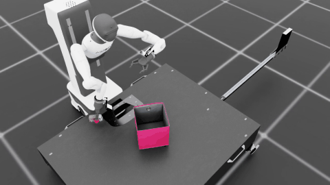
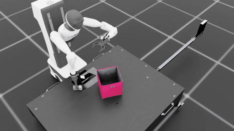
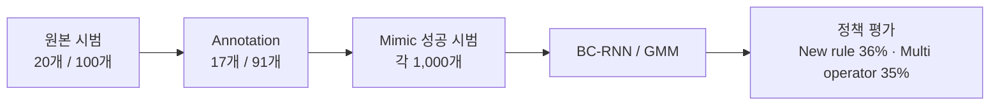

# Agibot Toy2Box 모방학습

**Agibot 오른팔로 트럭을 집어 상자 안에 놓는 정책**을 학습한다. 주된 연구 질문은 **조작자 1명과 다수의 시범으로 학습한 정책의 성능이 다른가**이다. 단일 실험과 혼합 실험을 각각 구성해 사용자 구성에 따른 차이를 비교했다.

원본 시범은 조건마다 **20개**, Mimic 성공 시범은 **500개**로 맞췄다. 학습 seed **101·111** 모델을 각각 평가한 결과, 평균 성공률은 **① 단일 사용자·단일 실험 30.5%, ② 단일 사용자·혼합 실험 43.5%, ③ 다수 사용자·단일 실험 30.0%, ④ 다수 사용자·혼합 실험 38.0%**였다.

## 1. 실험 구성

| 조건 | 사용자 구성 | 원본 시범 구성 | 원본 수 | Mimic 성공 시범 |
| --- | --- | --- | ---: | ---: |
| ① 단일 사용자·단일 실험 | 본인 1명 | S1 20개 | 20 | 500 |
| ② 단일 사용자·혼합 실험 | ①과 같은 본인 1명 | S1 10개 + S2 10개 | 20 | 500 |
| ③ 다수 사용자·단일 실험 | 본인 포함 5명, 각 4개 | 전부 S1 | 20 | 500 |
| ④ 다수 사용자·혼합 실험 | ③과 같은 5명, 각 4개 | 각자 S1 2개 + S2 2개 | 20 | 500 |

**단일 실험**은 S1 시범만 사용한 조건이고, **혼합 실험**은 S1·S2 시범을 같은 비율로 합친 조건이다. 혼합 실험도 전체 시범 수는 20개로 유지한다.

| 시범 유형 | 동작 규칙 |
| --- | --- |
| S1 · New rule | **회전 → XY 이동 → 수직 하강 → 그립 → 수직 상승 → 박스 이동 → 릴리즈** |
| S2 · XY 우선 | **XY 이동 → 회전 → 수직 하강 → 그립 → 수직 상승 → 박스 이동 → 릴리즈** |

두 유형 모두 수직 파지를 기준으로 한다. S2에서는 회전 뒤 필요한 경우 XY 위치를 재정렬한다.

사용자 구성은 **①↔③**, **②↔④**로 비교한다. 같은 사용자 구성에서 시범 혼합에 따른 차이는 **①↔②**, **③↔④**로 확인한다.

## 2. 평가 결과

평가 seed는 **42**, 모델마다 **100회 rollout**, 한도는 **800 step**이다. 1 step은 0.05초이므로 최대 40초다. 아래 성공률은 전달받은 평가 종료 집계값이며, 평균과 표준편차는 학습 seed 101·111의 두 성공률에서 계산했다.

| 조건 | seed 101 | seed 111 | 평균 ± 표준편차 |
| --- | ---: | ---: | ---: |
| ① 단일 사용자·단일 실험 | 30% (30/100) | 31% (31/100) | **30.5% ± 0.71%p** |
| ② 단일 사용자·혼합 실험 | 43% (43/100) | 44% (44/100) | **43.5% ± 0.71%p** |
| ③ 다수 사용자·단일 실험 | 32% (32/100) | 28% (28/100) | **30.0% ± 2.83%p** |
| ④ 다수 사용자·혼합 실험 | 32% (32/100) | 44% (44/100) | **38.0% ± 8.49%p** |

표준편차는 두 학습 seed를 표본으로 계산한 **표본 표준편차(n−1)**다. 평가 성공률의 신뢰구간이나 rollout 간 표준편차를 뜻하지 않는다. 총 8개 모델을 각각 100회 평가했다.

| 비교 | 평균 성공률 차이 | 관찰 |
| --- | ---: | --- |
| 단일 사용자에서 혼합 비교 · ②−① | **+13.0%p** | 두 seed 모두 혼합 실험이 13%p 높았다. |
| 다수 사용자에서 혼합 비교 · ④−③ | **+8.0%p** | seed 101은 차이가 없었고, seed 111은 혼합 실험이 16%p 높았다. |
| 단일 실험에서 사용자 구성 · ①−③ | **+0.5%p** | 평균은 비슷했고, seed별 우열이 달랐다. |
| 혼합 실험에서 사용자 구성 · ②−④ | **+5.5%p** | seed 101은 단일 사용자가 11%p 높았고, seed 111은 같았다. |

## 3. 가설과 결과 해석

**처음 가설:** 제한된 시범 수에서는 같은 사람이 같은 행동 패턴을 반복한 데이터가 학습에 유리할 것으로 예상했다. 따라서 단일 실험이 혼합 실험보다, 단일 사용자가 다수 사용자보다 높은 성공률을 보일 것으로 가정했다.

**혼합 실험의 결과는 첫 가설과 달랐다.** 단일 사용자에서는 30.5%에서 43.5%로, 다수 사용자에서는 30.0%에서 38.0%로 평균 성공률이 높아졌다. 이번 조건에서는 두 시범 유형을 섞는 것이 평균 성능 저하로 이어지지 않았다. 특히 단일 사용자 혼합 실험은 두 seed에서 모두 같은 폭으로 향상됐다.

**단일 사용자의 뚜렷한 우세는 확인하지 못했다.** 단일 실험에서는 차이가 0.5%p로 작았고, 혼합 실험에서는 단일 사용자가 평균 5.5%p 높았다. 따라서 사용자 구성의 결과까지 전부 예상과 반대였다고 해석하지 않는다. 다수 사용자 혼합 실험은 32%와 44%로 seed에 따른 변동도 컸다.

**가능한 설명:** S1·S2가 서로 다른 접근 자세와 경로의 시범을 제공해 정책이 접하는 상태를 넓혔을 수 있다. 다만 이는 후속 분석이 필요한 가설이다. S2 시범 자체의 난이도, 완료 시간, 파지 위치 등도 결과에 영향을 줄 수 있어, 성능 향상의 원인을 다양성이나 행동 일관성 하나로 확정하지 않는다.

학습 seed가 2개인 결과이므로 통계적 유의성이나 모든 조작자에 대한 일반적 우열을 주장하지 않는다. 이번 실험에서 가장 분명한 관찰은 **단일 사용자 혼합 실험이 두 seed 모두에서 단일 사용자 단일 실험보다 높은 성공률을 보였다는 점**이다.

## 4. 공통 조건과 학습 입력

| 항목 | 설정 |
| --- | --- |
| Task | `Isaac-Place-Toy2Box-Agibot-Right-Arm-RmpFlow-v0` |
| 환경·성공 판정·종료 조건 | 조건 간 동일 |
| 원본 / Mimic 성공 시범 | 조건마다 20개 / 500개 |
| 정책 | BC-RNN / GMM |
| LSTM / GMM | hidden 400 · 2 layers / 5 modes |
| 관측 / 행동 | 23차원 / 7차원 |
| Sequence / batch | 10 / 100 |
| 학습률 / epoch | 0.001 / 2000 |
| 학습 seed | 101, 111 |
| 평가 seed / rollout / horizon | 42 / 모델마다 100회 / 800 step |

8개 모델의 저장된 학습 설정에서 알고리즘·관측 설정과 epoch·batch·sequence가 같은 것을 확인했다. 학습 로그에서 각 조건의 입력 시범 수를, 실행 기록에서 평가 seed·rollout·horizon을 확인했다.

| 조건 | 학습에 사용한 Mimic 파일 |
| --- | --- |
| ① | `toy2box_agibot_mimic_new_rule_500.hdf5` |
| ② | `toy2box_agibot_mimic_single_mixed_500.hdf5` |
| ③ | `toy2box_agibot_mimic_multi_operator_c3_20_500.hdf5` |
| ④ | `toy2box_agibot_mimic_multi_operator_c4_20_500.hdf5` |

각 파일이 로컬에 준비된 상태에서 아래 명령의 `--dataset`만 해당 조건으로 바꾼다. 학습 seed는 과업 설정 JSON의 `train.seed`에서 지정한다.

```bash
./isaaclab.sh -p scripts/imitation_learning/robomimic/train.py \
    --task Isaac-Place-Toy2Box-Agibot-Right-Arm-RmpFlow-v0 \
    --algo bc \
    --dataset ./datasets/toy2box_agibot_mimic_new_rule_500.hdf5
```

seed별 결과와 계산값은 `results/experiment_results.json`에 저장했다.

## 5. 예비 실험 자료

기존 공개 데이터·모델·영상은 아래 **Mimic 1,000개·학습 seed 101의 예비 실험** 자료다. 위 4조건의 Mimic 500개 결과와 구분한다. 아래 모델과 영상을 이번 4조건의 평가 자료로 사용하지 않는다.

<details>
<summary>예비 실험의 데이터·모델·영상과 프로젝트 실행 방법</summary>

New rule 원본 **20개**, Multi operator 원본 **100개**를 준비하고, annotation 후 각 조건의 Mimic 성공 시범을 **1,000개씩** 확보했다. 두 모델 모두 학습 시드 **101**, epoch **2000**이며, **100회 평가 성공률은 New rule 36% (36/100), Multi operator 35% (35/100)**다.

## 1. 정책 동작 예시

| New rule · 예시 1 | New rule · 예시 2 |
| --- | --- |
| [](videos/new_rule_success_60.mp4) | [](videos/new_rule_success_99.mp4) |
| **Trial 60 · 전체 21.65초** | **Trial 99 · 전체 20.50초** |

| Multi operator · 예시 1 | Multi operator · 예시 2 |
| --- | --- |
| [](videos/multi_operator_success_1.mp4) | [](videos/multi_operator_success_13.mp4) |
| **Trial 1 · 전체 17.75초** | **Trial 13 · 전체 16.70초** |

파지·운반·상자 투입·릴리즈가 영상에서 확인되는 예시를 골랐다. 미리보기는 실제 영상의 마지막 6초를 원래 속도로 보여주며, 클릭하면 전체 MP4로 이동한다. 각 행은 해당 조건의 모델로 재생한 영상이다.

## 2. 무엇을 확인하려 하는가?

| 연구 질문 | 비교할 내용 | 함께 확인할 조건 |
| --- | --- | --- |
| 한 명과 여러 조작자의 시범으로 학습하면 성능이 달라지는가? | 단일 수집 구성과 여러 출처의 혼합 구성 | 수집자 정보·원본 수·동작 규칙·정지 비율 |
| 여러 유형의 시범을 혼합하면 학습에 어떤 영향을 주는가? | S1·S2의 시범 구성 | 동일한 학습 시범 수·모델·평가 조건 |

예비 실험은 원본 수가 **20개와 100개**로 다르고 혼합 구성에는 동작 규칙 차이도 있다. 따라서 성능 차이가 생겨도 조작자 수 하나의 효과로 단정하지 않는다. 시범 파일 5개가 곧 조작자 5명을 뜻하는 것도 아니다.

## 3. 데이터 구성



| 조건 | 원본 | Annotation | Mimic 성공 시범 | 원본 평균 시간 | 원본 평균 idle |
| --- | ---: | ---: | ---: | ---: | ---: |
| New rule keyboard | 20 | 17 | 1,000 | 28.19초 | 30.97% |
| Multi operator keyboard | 100 | 91 | 1,000 | 30.45초 | 31.44% |

Multi operator는 **New rule 20개 + 무규칙 키보드 수집 20개 + XY 우선 수집 20개 + 팀원 제공 시범 20개 + 조교님 시범 20개**를 합친 구성이다. 

제어 간격은 0.05초다. idle은 episode마다 이동·회전 action 6개가 모두 정확히 0인 프레임 비율을 구한 뒤 평균했다. 그리퍼 값은 제외한다. 저장된 시범의 성공 속성과 학습 정책의 성공률은 구분한다.

## 4. 동작 규칙

| 규칙 | 순서 | 
| --- | --- | 
| New rule | **회전 → XY 이동 → 수직 하강 → 그립 → 수직 상승 → 박스 이동 → 릴리즈** |
| XY 우선 | **XY 이동 → 회전 → 필요 시 XY 재정렬 → 수직 하강 → 그립 → 수직 상승 → 박스 이동 → 릴리즈** |
| 무규칙 키보드 수집 | **정해진 동작 순서 없이 조작자가 무작위로 조작하며 수집** |
| 하강 우선 | **수직 하강 → 회전 → XY 이동 → 그립 → 수직 상승 → 박스 이동 → 릴리즈** |

파지는 수직 자세를 기준으로 한다. 상승 뒤 물체가 박스 벽보다 높게 이동하도록 한다.

## 5. 모델과 학습 상태

| 항목 | 설정 |
| --- | --- |
| Task | `Isaac-Place-Toy2Box-Agibot-Right-Arm-RmpFlow-v0` |
| 정책 | BC-RNN / GMM |
| LSTM | hidden 400 · 2 layers |
| GMM | 5 modes |
| 관측 / 행동 | 23차원 / 7차원 |
| Sequence / batch | 10 / 100 |
| 학습률 / epoch | 0.001 / 2000 |

관측은 EE 위치·자세, 그리퍼 상태, 트럭 위치·자세, 박스 위치·자세로 구성한다. 행동은 상대 이동 3축·회전 3축·그리퍼 1개이며 팔 명령은 RMPFlow에 전달한다.

**평가 완료:** 두 조건 모두 학습 시드 101·epoch 2000 모델을 평가했다. 평가 seed는 42, 각 100회, 한도는 800 step이다. New rule은 **36회 성공(36%)**, Multi operator는 **35회 성공(35%)**했다.

| 조건 | 학습 시드 | 평가 seed | 평가 횟수 / 한도 | 성공률 |
| --- | ---: | ---: | --- | --- |
| New rule keyboard | 101 | 42 | 100회 / 800 step | **36% (36/100)** |
| Multi operator keyboard | 101 | 42 | 100회 / 800 step | **35% (35/100)** |

성공률은 전달받은 평가 종료 집계값이다. 공개 영상과 모델은 각 평가의 checkpoint로 맞췄다. 

## 6. 수집 원본과 평가 모델

저장소의 프로젝트 코드·데이터·모델·영상은 아래 경로에 직접 포함돼 있다.

| 조건 | 원본 데이터 | 평가 모델 |
| --- | --- | --- |
| New rule | [20개 HDF5](datasets/toy2box_agibot_new_rule_20_keyboard.hdf5) | [epoch 2000](models/new_rule/model_epoch_2000.pth) |
| Multi operator | [100개 HDF5](datasets/multi_operator_keyboard_100.hdf5) | [epoch 2000](models/multi_operator/model_epoch_2000.pth) |

배포본에서는 로컬 출처 경로를 익명 식별자로 바꿨으며, 초기 상태·관측·행동 배열과 시범 수는 유지했다. 실제 학습 입력은 원본을 annotation한 뒤 생성한 Mimic 성공 시범이다.

## 7. 실행 방법

Isaac Sim과 Toy2Box 자산이 설치된 수업용 `lerobot-arena` 환경을 사용한다. 이 저장소 자체가 IsaacLab_RS 프로젝트이며 `source/`, `scripts/`, `isaaclab.sh`, `datasets/`, `models/`, `videos/`를 포함한다. Isaac Sim 엔진과 외부 자산은 별도 설치한다.

```bash
conda activate lerobot-arena
cd ~
git clone https://github.com/Kim-KiSuk/Robotics-Simulation-Assignmnet2.git IsaacLab_RS_Toy2Box
cd ~/IsaacLab_RS_Toy2Box
```

수업 환경에 설치된 의존성을 유지하면서 현재 프로젝트의 Python 패키지 경로를 등록한다.

```bash
./isaaclab.sh -p -m pip install --no-deps \
    -e source/isaaclab \
    -e source/isaaclab_assets \
    -e source/isaaclab_tasks \
    -e source/isaaclab_mimic
```

학습 입력은 원본 HDF5가 아니라 annotation 후 생성한 Mimic 성공 시범 파일이다. 해당 파일이 로컬에 준비된 상태에서 실행한다.

**학습 명령어**

```bash
cd ~/IsaacLab_RS_Toy2Box

./isaaclab.sh -p scripts/imitation_learning/robomimic/train.py \
    --task Isaac-Place-Toy2Box-Agibot-Right-Arm-RmpFlow-v0 \
    --algo bc \
    --dataset ./datasets/toy2box_agibot_mimic_new_rule_keyboard_100.hdf5
```

학습 시드는 조교님이 과업 설정의 `train.seed`에서 지정한다. 학습 명령은 과업에 등록된 설정을 읽는다.

```text
source/isaaclab_tasks/isaaclab_tasks/manager_based/manipulation/place/config/agibot/agents/robomimic/bc_rnn_low_dim.json
```

Multi operator를 학습할 때는 `--dataset`만 아래 파일로 바꾼다.

```text
./datasets/toy2box_agibot_mimic_multi_operator_keyboard_100.hdf5
```

**Play 명령어**

저장소에 포함된 모델로 실행한다. Multi operator는 `--checkpoint ./models/multi_operator/model_epoch_2000.pth`, `--video_folder ./videos/toy2box_multi_operator`로 바꾼다.

```bash
cd ~/IsaacLab_RS_Toy2Box

./isaaclab.sh -p scripts/imitation_learning/robomimic/play.py \
    --task Isaac-Place-Toy2Box-Agibot-Right-Arm-RmpFlow-v0 \
    --checkpoint ./models/new_rule/model_epoch_2000.pth \
    --num_rollouts 100 \
    --horizon 800 \
    --video \
    --video_length 1000 \
    --video_folder ./videos/toy2box_new_rule \
    --headless
```

평가 시드는 조교님이 지정하는 값으로 실행한다. 위 표의 학습·평가 시드는 게시한 36%·35% 결과의 기록이다. 재학습·평가 시 사용할 시드를 지정하는 안내와 구분한다.


## 8. 저장소 구성

| 경로 | 내용 |
| --- | --- |
| `source/` | IsaacLab·과업·로봇·Mimic 코드와 설정 |
| `scripts/` | 학습·평가·증강·데이터 도구 |
| `isaaclab.sh` | 프로젝트 실행 |
| `datasets/` | New rule 20개·Multi operator 100개 수집 원본 |
| `models/` | 두 조건의 epoch 2000 평가 모델 |
| `videos/` | 두 조건에서 선별한 성공 예시 전체 MP4 |
| `artifacts/media/` | 실제 영상의 GIF 미리보기 |
| `tools/` | 원본 프로젝트 도구와 데이터 병합·평가 집계 |
| `results/dataset_summary.json` | 실험 데이터 개수·통계·파일 해시 |

</details>

## 참고

[IsaacLab_RS](https://github.com/cailab-hy/IsaacLab_RS)와 [Isaac Lab](https://github.com/isaac-sim/IsaacLab)을 기반으로 한다. [라이선스](LICENSE)
