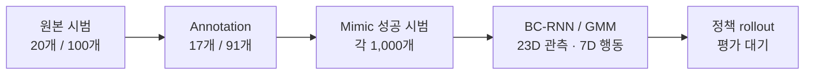

# Agibot Toy2Box 모방학습

**Agibot 오른팔로 트럭을 집어 상자 안에 놓는 정책**을 학습한다. 연구 축은 **조작자 1명 vs 다수**이며, 시범의 구성과 동작 순서가 정책 성능에 어떤 차이를 만드는지 살펴본다.

**2026-11-01~02 진행:** New rule 원본 20개와 Multi operator 원본 100개를 준비하고, annotation 후 각 조건의 Mimic 성공 시범을 **1,000개씩** 확보했다. **정책 rollout은 평가 대기**이며, 이번 조건의 영상과 성공률은 아직 없다.

[문제·가설](docs/METHOD.md) · [진행 현황](docs/RESULTS.md) · [구현](docs/IMPLEMENTATION.md) · [재현 명령](docs/REPRODUCE.md) · [영상 상태](docs/MEDIA.md)

## 1. 무엇을 확인하려 하는가?

| 연구 질문 | 비교 구성 | 해석할 때 확인할 조건 |
| --- | --- | --- |
| 한 명과 여러 조작자의 시범으로 학습하면 성능이 달라지는가? | 단일 수집 구성과 여러 출처의 혼합 구성 | 수집자 정보·원본 수·동작 규칙·정지 비율 |
| 동작 순서가 다른 시범을 섞으면 일관성과 다양성이 어떻게 작용하는가? | 회전 후 접근과 XY 접근 후 회전 | 같은 학습 시범 수·학습 설정·평가 조건 |

이번 준비 자료는 원본 수가 **20개와 100개**로 다르고, 혼합 조건에는 서로 다른 동작 규칙도 들어간다. 이후 성공률 차이가 확인돼도 조작자 수 하나의 효과로 단정하지 않는다.

## 2. 수집 원본에서 학습까지



| 조건 | 원본 | Annotation | Mimic 성공 시범 | 정책 평가 |
| --- | ---: | ---: | ---: | --- |
| New rule keyboard | 20 | 17 | 1,000 | 대기 |
| Multi operator keyboard | 100 | 91 | 1,000 | 대기 |

원본 개수, annotation 개수, 증강 후 학습 시범 수는 서로 다른 값이다. 저장된 시범의 성공 속성은 학습 정책의 성공률이 아니다.

## 3. 동작 규칙과 혼합 데이터 구성

| 규칙 | 동작 순서 |
| --- | --- |
| New rule | **회전 → XY 이동 → 수직 하강 → 그립 → 수직 상승 → 박스 이동 → 릴리즈** |
| XY 우선 | **XY 이동 → 회전 → 필요 시 XY 재정렬 → 수직 하강 → 그립 → 수직 상승 → 박스 이동 → 릴리즈** |
| 하강 우선 · 별도 수집 구성 | **수직 하강 → 회전 → XY 이동 → 그립 → 수직 상승 → 박스 이동 → 릴리즈** |

파지 자세는 수직으로 맞춘다. 상승 시에는 물체가 박스 벽을 넘을 수 있는 높이를 확보한다. 하강 우선 구성은 이번 혼합 원본 100개에 포함되지 않았다.

**Multi operator 구성:** New rule 20개, 기본 수집 20개, XY 우선 수집 20개, 팀원 제공 시범 20개, 조교님 시범 20개를 합쳐 총 100개다. 이 명칭은 자료 구성을 나타내며, 파일 5개만으로 수집자 5명을 확인한 것은 아니다.

## 4. 확인된 데이터 특성

| 원본 | 총 step | 평균 길이 | 평균 idle |
| --- | ---: | ---: | ---: |
| New rule keyboard 20 | 11,276 | 28.19초 | 30.97% |
| Multi operator keyboard 100 | 60,892 | 30.45초 | 31.44% |

제어 간격은 0.05초다. idle은 이동·회전 action 6개가 모두 정확히 0인 프레임 비율을 episode별로 구한 뒤 평균했다. 그리퍼 값은 제외한다.

[수치·파일 해시 JSON](results/keyboard_study_20261102.json) · [요약 CSV](results/keyboard_study_20261102.csv)

## 5. 학습 설정과 평가 대기

| 항목 | 설정 / 상태 |
| --- | --- |
| 정책 | BC-RNN / GMM, LSTM hidden 400 · 2 layers · GMM 5 modes |
| 관측 / 행동 | 23차원 / 7차원 |
| Sequence / batch | 10 / 100 |
| 학습률 / 목표 epoch | 0.001 / 2,000 |
| 시드 101 | New rule 학습 완료 기록 확인; 별도 동일 시드 학습 진행 기록도 있음 |
| 시드 100 | 비교용 JSON 준비; 실행·완료 기록 미확인 |
| Multi operator 학습 | 이번 데이터로 학습한 완료 모델 미확인 |
| Rollout · 성공률 · 영상 | **평가 대기** |

시드가 다른 두 설정을 준비한 것과 두 모델의 학습·평가가 끝난 것은 구분한다. 평가 전 가중치를 최종 배포 모델로 지정하지 않았다. [학습 확인 범위](docs/training_status.md)

## 6. 원본 다운로드와 재현

증강 전 원본 두 개와 SHA256을 [Keyboard study Release](https://github.com/Kim-KiSuk/Robotics-Simulation-Assignmnet2/releases/tag/keyboard-study-2026-11-02)에 제공한다. New rule은 **20개**, Multi operator는 **100개**이며 파일 내용은 그대로 유지했다.

```bash
gh release download keyboard-study-2026-11-02 \
  --repo Kim-KiSuk/Robotics-Simulation-Assignmnet2 \
  --pattern '*.hdf5' --pattern SHA256SUMS --dir data
cd data
sha256sum -c SHA256SUMS
```

학습 설정을 고르려면 `--config`에 JSON 경로를 지정한다. `--name`은 결과 저장 이름이며 실제 시드는 JSON의 `train.seed`로 결정된다. [설치·시드별 학습 명령](docs/REPRODUCE.md)

| 자료 | 내용 |
| --- | --- |
| [Method](docs/METHOD.md) | 연구 질문·가설·비교 조건·한계 |
| [Implementation](docs/IMPLEMENTATION.md) | 상태 관측·행동·모델·설정 선택 |
| [Results](docs/RESULTS.md) | 데이터·증강 진행과 평가 대기 항목 |
| [Reproduce](docs/REPRODUCE.md) | 설치·데이터·학습 명령 |
| [데이터 구성](docs/data_collection.md) | 혼합 원본 구성과 동작 규칙 |
| [시드별 JSON](configs/keyboard) | 시드 101·100의 학습 설정 |
| [이전 조건 기록](docs/experiments.md) | 이번 keyboard 조건과 구분한 기존 실험 |

## 참고

[IsaacLab_RS 고정 원본](https://github.com/cailab-hy/IsaacLab_RS/tree/e83a5d2f11ca1b5f03b690e1978479e620c500e2)과 [Isaac Lab](https://github.com/isaac-sim/IsaacLab)을 기반으로 한다. [출처·라이선스](THIRD_PARTY_NOTICES.md)
