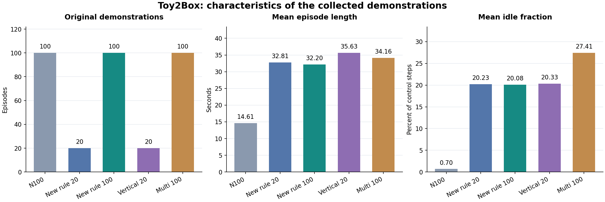

# 실험 결과와 확인 범위

## 수집 원본과 학습 구성

| 실험 | 원본 | Annotation | 학습 시범 | 원본 평균 길이 | 원본 idle 평균 |
| --- | ---: | ---: | ---: | ---: | ---: |
| n100 | 100 | 99 | 500 | 14.61초 | 0.70% |
| New rule 20 | 20 | 19 | 1,000 | 32.81초 | 20.23% |
| New rule 100 | 100 | 98 | 1,000 | 32.20초 | 20.08% |
| Vertical | 20 | 20 | 1,000 | 35.63초 | 20.33% |
| Multi operator | 100 | 93 | 1,000 | 34.16초 | 27.41% |

모든 모델은 학습 seed 101, epoch 2000이다. 그래프는 수집 원본의 개수·시간·idle이며 정책의 성공률이 아니다. 표의 원본 통계는 episode별 값의 평균이다.

[요약 CSV](../results/experiment_summary.csv) · [요약 JSON](../results/experiment_summary.json) · [원본 manifest](../data/experiment_manifest.json) · [학습 config](../configs/experiments)

## 정책 평가 상태

정확한 정책 성공률은 다섯 조건 모두 미확정이다. 평가 명령 이력과 영상은 남아 있지만, 100회 trial별 성공 판정과 최종 집계 출력이 저장된 로그를 확보하지 못했다. 다른 실험자의 성공률이나 저장 원본의 성공 속성을 이 모델들의 평가 결과로 사용하지 않는다.

기본 선택 모델은 New rule 100의 run `20261101015656`이며, 기존 rollout 영상 100개와 연결한 [근거 기록](../submission/model_smoke_check.json)이 있다. 해당 checkpoint를 CPU로 로드하고 config·해시를 확인했다. 이번 문서·영상 정리 과정에서 시뮬레이터 재평가를 실행하지 않았다.

영상 프레임 수 점검 — 성공률로 사용하지 않음

| 조건 | 영상 수 | 800프레임 미만 | 800프레임 |
| --- | ---: | ---: | ---: |
| New rule 20 | 100 | 56 | 44 |
| New rule 20 재실행 | 100 | 56 | 44 |
| New rule 100 | 100 | 68 | 32 |
| Vertical | 100 | 43 | 57 |
| Multi operator | 100 | 32 | 68 |

이 숫자는 영상 개수다. 조기 종료에는 실패가 포함될 수 있어 성공 횟수로 바꾸지 않는다. 같은 모델의 재실행을 독립 학습 seed로 세지 않는다. n100의 공용 영상 폴더는 다른 checkpoint 평가에도 재사용되어 결과를 연결하지 않는다. [프레임 inventory](../reports/policy_video_inventory.json)

## 저장 action 재생

| 원본 | 재생 수 | 성공 조건 10 step 연속 충족 |
| --- | ---: | ---: |
| New rule 20 | 20 | 20 |
| New rule 100 | 100 | 100 |
| Vertical | 20 | 20 |
| Multi operator | 100 | 91 |

초기 상태를 복원하고 원본 action을 그대로 실행한 검사다. 정책의 독립 평가와 구분한다. 혼합 원본 중 재생 성공 조건을 충족하지 않은 9개는 별도 확인 대상이며, annotation에서 빠진 7개와 같은 시범이라고 단정하지 않는다. [전체 재생 판정](../reports/replay_inventory.json)

## 해석과 다음 검증

원본 특성의 차이는 확인됐지만 정책 성능 순위는 확정할 수 없다. New rule과 혼합 수집의 차이를 조사할 때 동작 순서·idle·원본 구성의 차이를 함께 고려한다. n100의 학습 시범 수 500개와 다른 조건의 1,000개 차이도 통제해야 한다.

New rule 20의 action·EE 궤적 지문 20개 모두 100개 원본에서도 일치했다. 두 원본을 독립적인 수집 표본으로 간주하지 않는다. [중복 검사 기록](../results/data_overlap.json)

다음 단계는 같은 조건에서 각 모델을 100회 평가하고 결과 로그를 저장하는 것이다. 학습 seed를 추가하고, 겨냥한 실패 단계의 감소를 함께 확인해야 한다. [재평가 명령](REPRODUCE.md) · [실험 방법](METHOD.md)
